# Internship Radar

**An AI-assisted internship pipeline that finds, ranks and tracks startup roles end to end.** It scans 800+ startup career pages every morning, rates every new posting against my CV with an LLM, syncs application status from my inbox, and writes a one-pager briefing as soon as an interview invite arrives.

I built it for my own search for a Founder's Associate / Venture Development internship, and I use it every day.

**[▶ Open the live demo](https://emgidrei.github.io/internship-radar/)**: the real app with fictional companies and data, no login needed. Press the blue scan button in the top right to watch a simulated scan run.

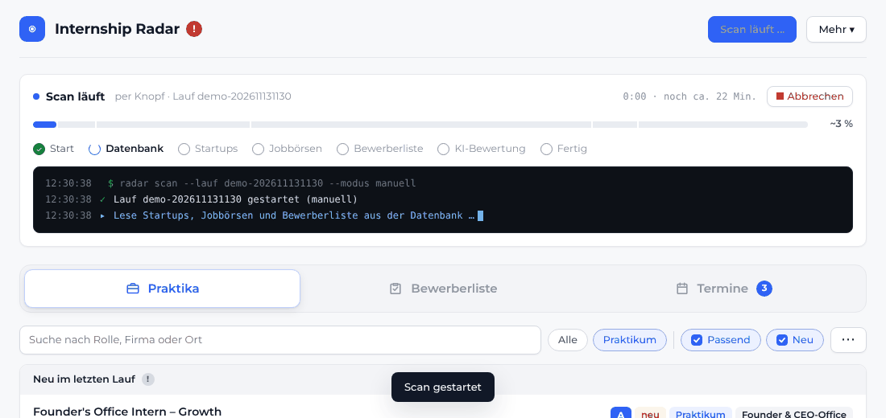

---

## Why

The roles I'm looking for (Founder's Associate, Chief of Staff, Venture Development at seed to Series B startups) rarely show up on the big job boards. They sit on hundreds of individual career pages: Personio, Ashby, Greenhouse, Lever, Join, plain websites. Checking them by hand doesn't scale, and generic job alerts are mostly noise. I wanted one place that:

1. sees every relevant posting the morning it goes live,
2. tells me which ones are actually worth my time, and why,
3. keeps the whole application process (status, emails, interviews, preparation) in one view without manual bookkeeping.

## What it does

### 1. Discover: a daily scan of 800+ startups
- **Direct reads from applicant tracking systems.** Native adapters cover Personio (XML feed, with an HTML fallback when the feed is disabled), Ashby, Greenhouse (US/EU), Lever (US/EU), Workable, Recruitee, SmartRecruiters, Join (paginated Next.js state), Teamtailor (RSS) and Y Combinator company pages. A generic HTML link extractor handles everything else. No LLM call per page: the scan is deterministic Python and finishes in about 20 minutes.
- **Job boards and VC portfolios.** Y Combinator Jobs, Getro-powered VC portfolio boards, Berlin Startup Jobs and the Arbeitnow API, filtered to internship-type roles in Germany, Paris and Lille.
- **A startup base that grows itself.** Companies discovered on those boards whose ATS can be read are proposed as *candidates*. One click adds them to the daily scan. Startups without a known careers page are resolved automatically by `scanner/discover.py`, which guesses the website, finds the ATS link and verifies that the board really belongs to that company.
- **A keyword classifier before any AI.** Role type (internship, working student, founder's office, venture development, …), topic tags (Strategy, Automation, BizDev & Growth, …) and hard exclusions (engineering, HR, pure sales, …) decide what counts as *relevant*.
- **Responsible scraping.** At most 4 parallel requests per host, `Crawl-delay` from robots.txt honoured on the job boards, nothing behind a login, and no LinkedIn, Indeed or Wellfound scraping.

### 2. Rank: an LLM rating of every new posting against my profile
- For each **new** posting (and anything I put on my list), the scan fetches the job description (JSON-LD `JobPosting` where available) and Claude scores it on three axes: **Fit** (CV and preferences), **Impact** (ownership, founder exposure) and **Startup strength** (funding, investors, traction), plus a one-sentence reason.
- A fixed formula, not the model, turns those into a score and a **priority A–D**: `0.45·fit + 0.35·impact + 0.20·startup`, and a fit below 35 always gives D.
- Only new postings are rated, so the cost stays flat as the database grows. When I edit my profile, the application list is rated again.

### 3. Track: an application list that maintains itself
- **Pipeline and Kanban board.** Statuses run from *open* through *must apply*, *cover letter needed*, *applied*, *interview*, *2nd/3rd interview* to *offer*, *rejected* or *not relevant*. Each row and card is colour-coded by status, and the funnel shows conversion between stages.
- **Posting health.** Each morning every application link is re-checked: the start date is extracted from free text (DE/EN/FR), along with an *online since* date. A posting is marked *offline* when its board was fully read and the job is gone. A *re-posted* job (same role, new ID) is detected and linked to the new ad.
- **Inbox sync three times a day.** A scheduled Claude agent reads Gmail, matches each mail to the right application (ATS sender domains, multiple roles at the same company, stealth companies) and moves the status forward: confirmation → *applied*, invite → *interview*, rejection → *rejected*. It appends one dated line per mail to the notes field, never overwrites, and keeps a processed-message log so nothing is counted twice.

### 4. Prepare: interview calendar and automatic one-pagers
- When the inbox sync detects an **interview invite**, it creates a calendar entry with the booking link, the interviewer and, if it appears in the signature, their LinkedIn profile. The entry becomes *booked* once a confirmation with date and time arrives.
- For every new interview the agent researches the company (at most 5 web searches plus the company website and the job ad) and writes a **one-pager**: what they do, facts (HQ, founding year, funding, investors, founders, traction), product, ICP, business model, competitors, what to watch for, smart questions to ask, and how my CV connects to the role, with sources.
- Clicking any calendar entry opens the one-pager.

### Small things that make it pleasant to use
Live progress panel with a terminal-style log and a hard cancel that stops the cloud session immediately · the prio badge opens a breakdown of the score · hide/grey-out for postings · resizable columns and sortable headers · Excel-style multi-line notes · trash with restore · error and alert inbox · dark mode · mobile layout.

## Screenshots

| Discover and rank | Track |
|---|---|
| 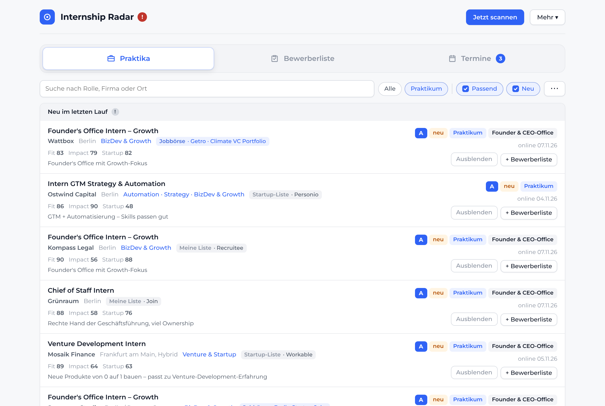 | 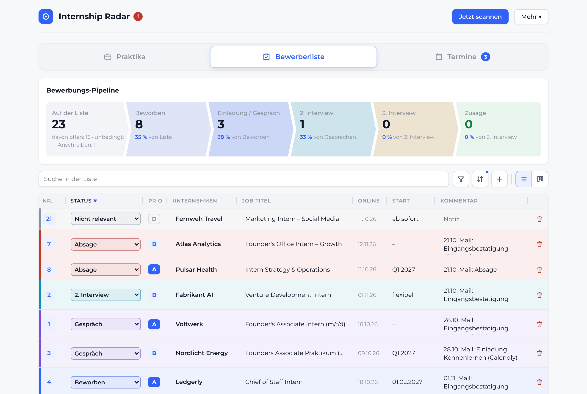 |
| 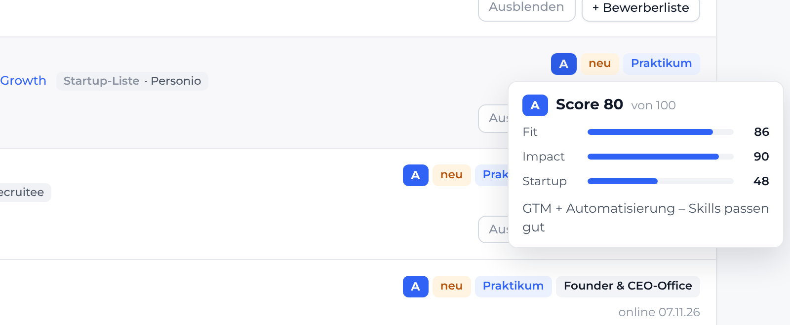 | 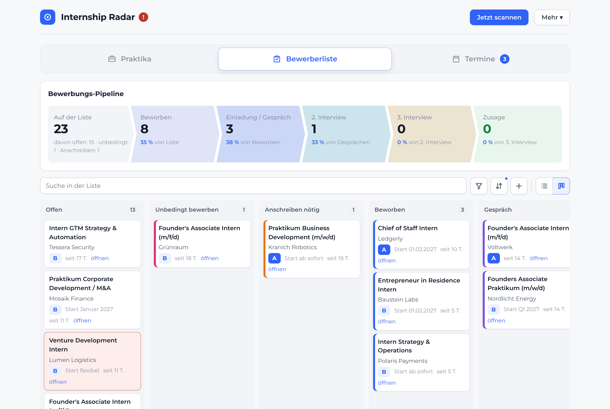 |

| Interview calendar | Auto-generated one-pager |
|---|---|
| 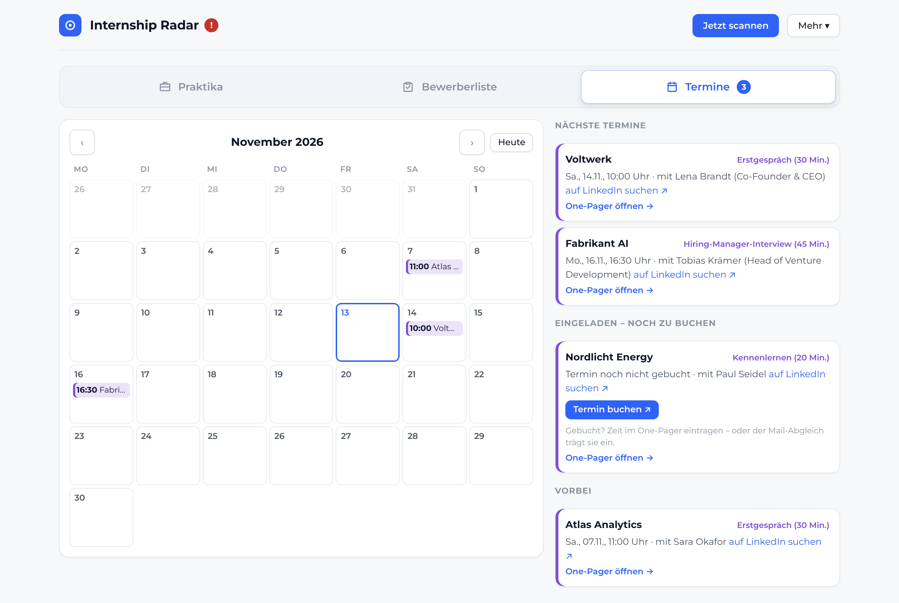 | 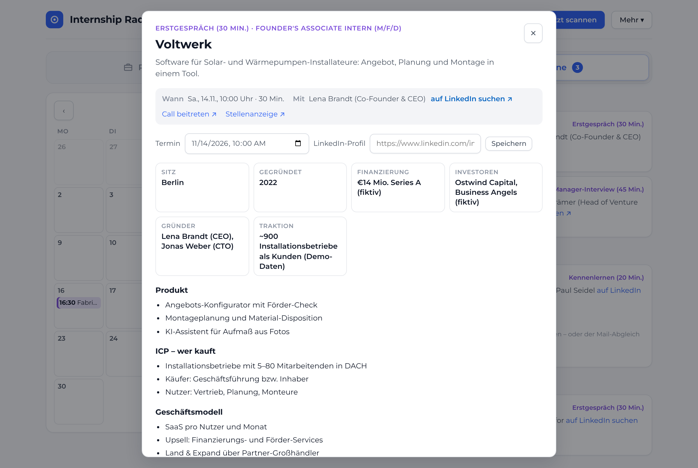 |

| Live scan | Dark mode | Mobile |
|---|---|---|
| 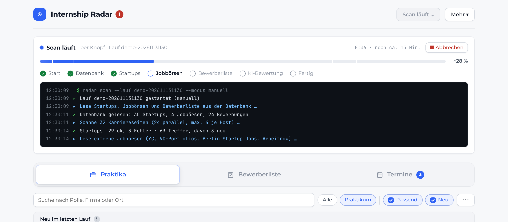 | 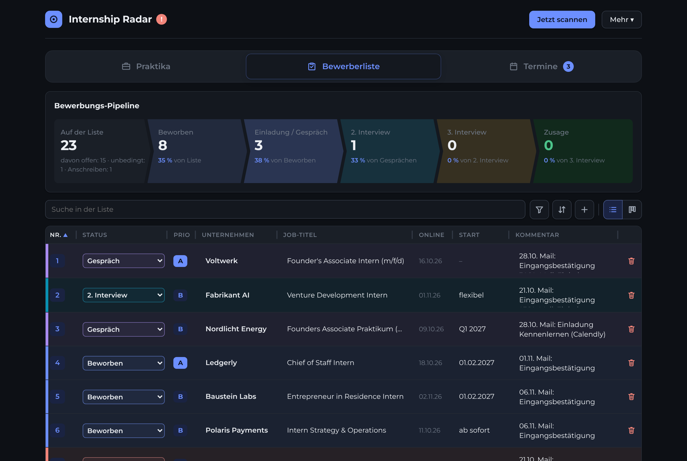 | 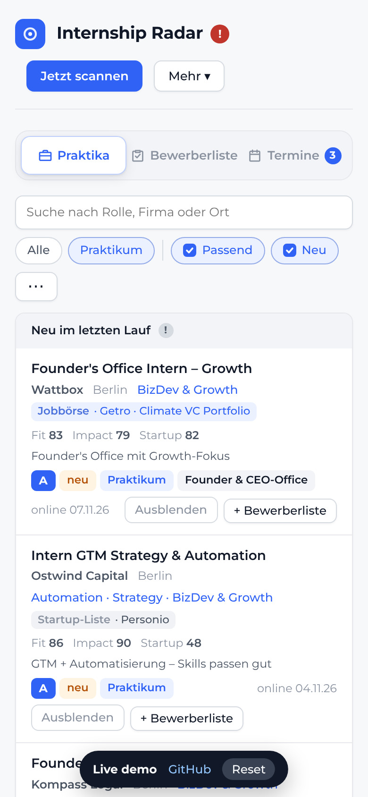 |

*Screenshots are taken from the demo with fictional data. The UI is in German; feature names in this README are translated.*

## How it works

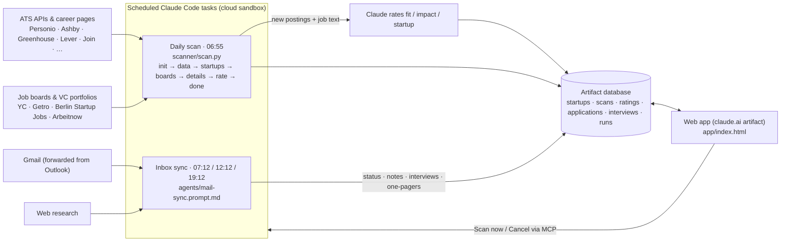

- **Web app** (`app/index.html`): a single-file vanilla JS/CSS app running as a claude.ai artifact. It reads and writes a document database through the artifact runtime with live snapshot listeners, and starts or cancels the scheduled scan through an MCP connector (Claude Code Remote).
- **Scanner** (`scanner/scan.py`): standard-library Python with no dependencies. The scheduled task calls it phase by phase and writes progress after each phase, which drives the live progress bar in the app. Writes use optimistic concurrency (`if_version`), and a version conflict on the run document is how a cancel from the UI reaches the run.
- **Agents** (`agents/`): the prompts of the two scheduled tasks are versioned like code. `agents/build_prompt.py` renders the scan prompt, which embeds `scanner/scan.py` because the sandbox doesn't clone this repo, and the rendered output is checked byte-for-byte against the deployed task.
- **Demo** (`demo/`, served from `docs/`): the unchanged app plus `demo/mock-runtime.js`, an in-browser stand-in for the artifact database and MCP connector, backed by generated sample data and localStorage.

More detail is in [docs/architecture.md](docs/architecture.md).

## Design decisions

- **No LLM in the crawl loop.** An early version had Claude read each careers page. It was slow, expensive and nondeterministic. Moving discovery to explicit ATS adapters made scans far faster, cheaper and reproducible, and the model is now used only where judgement adds value: rating postings and writing briefings.
- **The rules sit in code, judgement in the model.** The model returns three sub-scores and a reason, and code computes the priority. Status transitions in the inbox sync follow explicit rules: a status only moves forward, a rejection can override anything except an offer, and manual edits win.
- **Idempotent, append-only automation.** The agents never delete or rewrite what I typed. Notes are append-only, each mail is processed once, and every write carries a version check.
- **Mail and web content are treated as data, not instructions.** The agents only read mail (no sending, labelling or deleting) and are told explicitly not to follow instructions found in mails or web pages.

## Repository layout

```
app/index.html            the web app (deployed as a claude.ai artifact)
scanner/scan.py           daily scan: ATS adapters, job boards, posting health, AI-rating prep
scanner/discover.py       find careers pages / ATS boards for new startups
scanner/filters.py        keyword classifier prototype
agents/                   prompts of the scheduled Claude tasks + renderer
demo/                     sample-data generator, mock runtime, demo build
docs/                     GitHub Pages: live demo (index.html), screenshots, architecture notes
```

## Run it locally

```bash
# open the demo
python3 demo/make_data.py && python3 demo/build.py && open docs/index.html

# run the scanner against your own input data (see docs/architecture.md for the input layout)
RADAR_DIR=/tmp/radar python3 scanner/scan.py alles

# render the scheduled-task prompt
RADAR_ARTIFACT_URL=https://claude.ai/artifact/... python3 agents/build_prompt.py scan-run > prompt.txt
```

## Built with Claude Code

I built this with Claude Code as my pair programmer, over about 40 iterations across a month of daily use. My part was the product: deciding what to automate and what not to, the rating and status rules, the data model, the trade-offs such as dropping the per-page LLM crawl, and constant iteration from real use. Each feature came from a concrete annoyance in my own application process: postings that went offline unnoticed, untracked emails, unprepared first calls.
